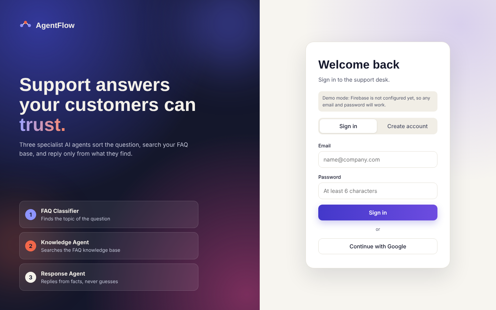
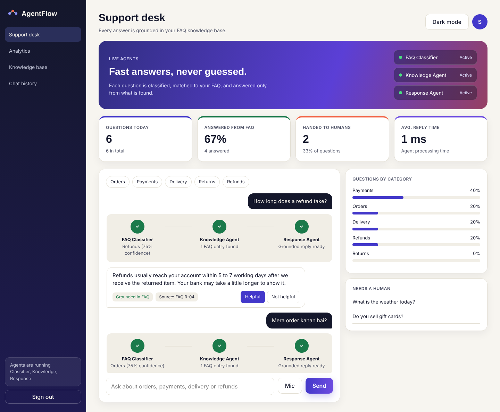
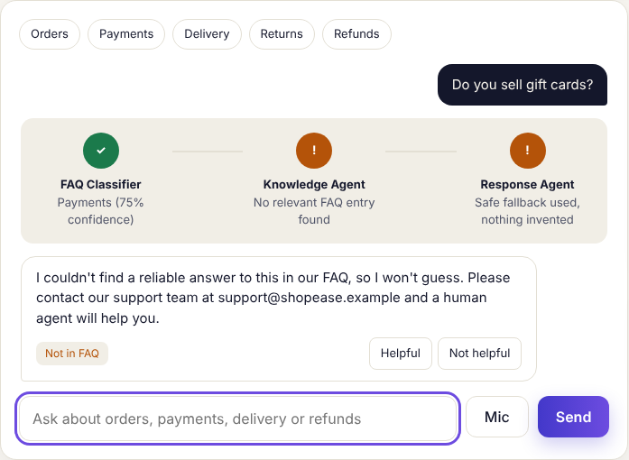
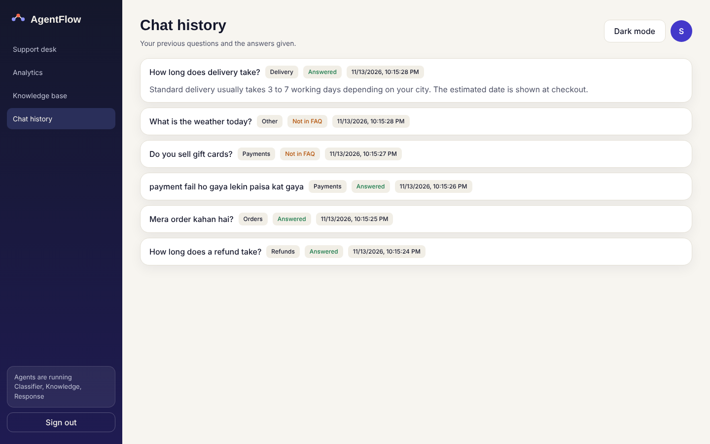
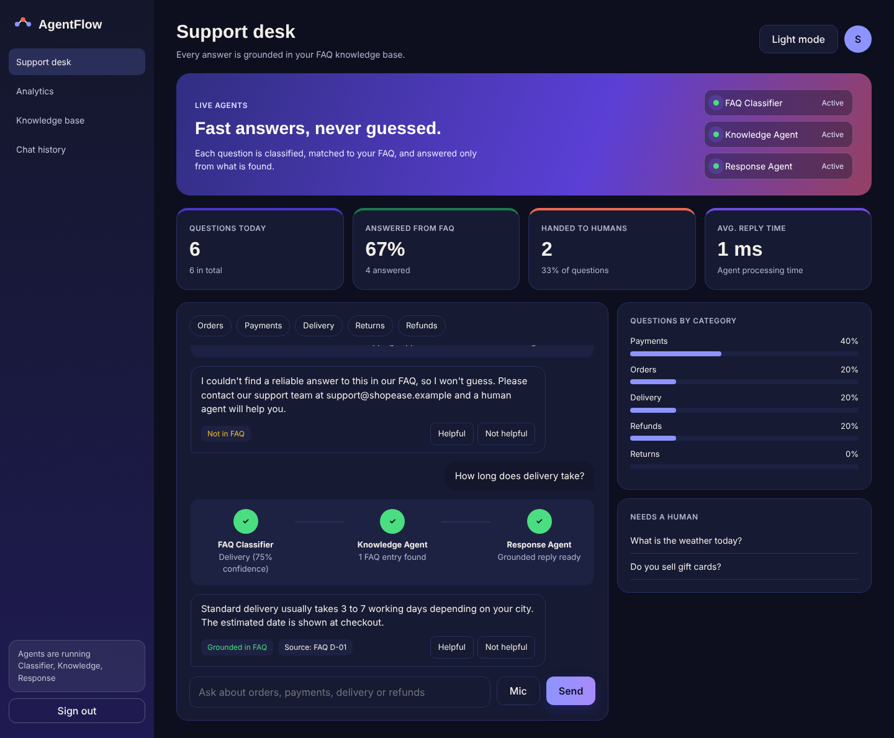
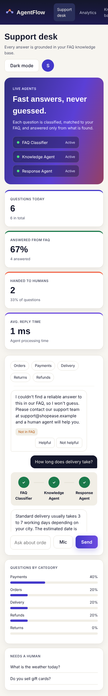
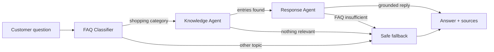

<div align="center">

# AgentFlow – AI FAQ Assistant

**A three-agent customer support assistant that answers only from your FAQ knowledge base, and never invents an answer.**




</div>

## Overview

An online shopping company receives hundreds of customer questions about orders, payments, deliveries, returns and refunds. AgentFlow automates the first line of support with three specialised AI agents that work as a pipeline:

| Agent | Role | Responsibility |
|---|---|---|
| **FAQ Classifier** | Question classification specialist | Understands the question and identifies its category |
| **Knowledge Agent** | FAQ knowledge specialist | Retrieves relevant entries from the knowledge base |
| **Response Agent** | Customer support specialist | Writes a clear reply grounded in the retrieved entries |

If the knowledge base has no answer, the assistant says so and offers a human agent instead of guessing.

## Features

- **Three-agent LangGraph pipeline** with a conditional fallback branch that guarantees no invented answers
- **Live agent pipeline** in the UI, so users see each agent working and which FAQ entries were used
- **Source citations** on every answer and Helpful / Not helpful feedback
- **English and Roman Urdu** questions supported (keywords, classifier and response language)
- **Firebase Authentication** (email/password and Google) with a custom login page
- **Chat history** per user in Firestore
- **Dashboard and Analytics** computed from real conversations: volume, answer rate, feedback, categories, unanswered questions
- **Knowledge base browser** with search and category filters
- Dark and light mode, voice input, responsive layout
- **Demo mode**: runs without Firebase or an API key for quick testing

## Screenshots

| Support desk | Agent pipeline running |
|---|---|
|  |  |
| **No-guessing fallback** | **Analytics** |
|  |  |
| **Knowledge base** | **Chat history** |
|  |  |
| **Dark mode** | **Mobile** |
|  |  |

## Architecture



- **Classifier**: Groq LLM returns `{category, confidence}`; a keyword classifier is the fallback if the LLM is unavailable.
- **Knowledge Agent**: BM25 ranking over the FAQ entries (question, keywords and answer), with a coverage threshold so weak matches are rejected.
- **Response Agent**: the LLM may only use the retrieved entries and must reply `NOT_FOUND` if they do not answer the question.
- **Fallback node**: a fixed message with no LLM call, so nothing can be invented.

## Tech stack

| Layer | Technology |
|---|---|
| Agents | Python, LangGraph, LangChain-Groq |
| LLM | Groq (Llama models, configurable) |
| API | Vercel Python serverless functions |
| Frontend | HTML, CSS, JavaScript (ES modules), no build step |
| Auth and database | Firebase Authentication and Firestore |
| Hosting | Vercel (frontend and API), Firebase (auth and data) |

## Project structure

```
faq-assistant/
├── api/                    # Vercel serverless endpoints
│   ├── chat.py             # POST /api/chat
│   ├── faqs.py             # GET  /api/faqs
│   └── health.py           # GET  /api/health
├── backend/
│   ├── faq_assistant/
│   │   ├── agents/         # classifier.py, knowledge.py, responder.py
│   │   ├── knowledge_base/ # faqs.json (31 FAQ entries)
│   │   ├── graph.py        # LangGraph pipeline
│   │   ├── config.py, llm.py, text.py, cli.py
│   └── tests/              # offline unit tests
├── frontend/
│   ├── index.html          # login and sign up
│   ├── app.html            # support desk, analytics, knowledge base, history
│   ├── css/  js/  assets/
├── firebase/firestore.rules
├── docs/                   # screenshots, diagrams, report (.docx), presentation (.pptx)
├── dev_server.py           # run everything locally
├── vercel.json
└── requirements.txt
```

## Getting started

**Requirements:** Python 3.10 or newer.

```bash
git clone <your-repo-url> && cd faq-assistant
pip install -r requirements.txt
cp .env.example .env          # then add your GROQ_API_KEY
python dev_server.py          # open http://127.0.0.1:3000
```

Without `GROQ_API_KEY` the app runs in demo mode (keyword classifier and direct FAQ answers). Without Firebase keys, sign-in accepts any email and password and chats are stored in the browser.

Try it from the terminal:

```bash
cd backend
python -m faq_assistant.cli "How long does a refund take?"
```

### Environment variables

| Variable | Purpose | Default |
|---|---|---|
| `GROQ_API_KEY` | Groq API key | none (demo mode) |
| `CLASSIFIER_MODEL` | Model for the classifier | `llama-3.1-8b-instant` |
| `RESPONSE_MODEL` | Model for the response agent | `llama-3.1-8b-instant` |
| `SUPPORT_EMAIL` | Contact shown in the fallback message | `support@shopease.example` |

## API

`POST /api/chat` with `{"question": "How long does a refund take?"}` returns:

```json
{
  "category": "refunds",
  "confidence": 0.75,
  "status": "answered",
  "answer": "Refunds usually reach your account within 5 to 7 working days ...",
  "sources": [{ "id": "R-04", "category": "refunds", "question": "How long does a refund take?", "score": 12.64 }],
  "trace": [{ "agent": "FAQ Classifier", "status": "done", "summary": "Refunds (75% confidence)" }]
}
```

`status` is `answered` or `no_answer`. `GET /api/faqs` lists the knowledge base and `GET /api/health` reports whether an LLM key is configured.

## Testing

```bash
python -m unittest discover -s backend/tests
```

The tests run offline and cover classification, retrieval, the no-guessing behaviour for unknown and out-of-scope questions, and the full pipeline.

### Evaluation

`python backend/tests/evaluate.py` runs 28 labelled in-scope questions (English and Roman Urdu) and 6 questions that are not in the FAQ. In demo mode (no API key) the results were:

| Metric | Result |
|---|---|
| Category accuracy | 28 / 28 |
| Correct FAQ ranked first | 27 / 28 |
| Questions not in the FAQ correctly refused | 6 / 6 |

The question set was written by the author and the FAQ keywords were refined using it, so treat these numbers as a sanity check rather than an independent benchmark. Re-run the script with `GROQ_API_KEY` set to evaluate the LLM mode.

## Deployment (Vercel and Firebase)

**1. Firebase**
1. Create a project at the [Firebase console](https://console.firebase.google.com).
2. Authentication → Sign-in method → enable **Email/Password** and **Google**.
3. Firestore Database → create a database, then paste `firebase/firestore.rules` into the Rules tab and publish.
4. Project settings → Your apps → add a **Web app** and copy its config into `frontend/js/config.js`.

**2. Vercel**
1. Push the repository to GitHub and import it in [Vercel](https://vercel.com) (framework preset: *Other*).
2. Add the environment variables from the table above under Project Settings → Environment Variables.
3. Deploy.
4. Copy the Vercel domain and add it in Firebase → Authentication → Settings → **Authorized domains**, otherwise Google sign-in will be blocked.

## Limitations and future work

- `/api/chat` does not yet verify Firebase ID tokens, so the API is open to anyone who knows the URL. Token verification and rate limiting are the first production hardening steps.
- The knowledge base is a JSON file edited in the repository; an admin screen for editing FAQs is not included.
- Retrieval uses BM25 keywords; embedding-based search would improve matching of paraphrased questions.
- The order-tracking demo and live order data are out of scope.

## Author

**Anushay Ayat** (Roll No. 773317), AI and Data Science, Saylani IT Training. Instructor: Mehwish Alam.

## License

MIT, see [LICENSE](LICENSE).
