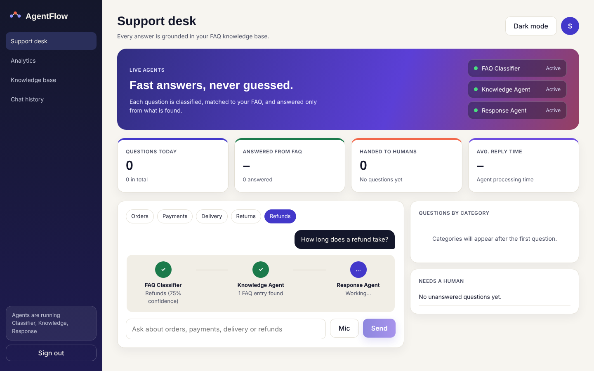
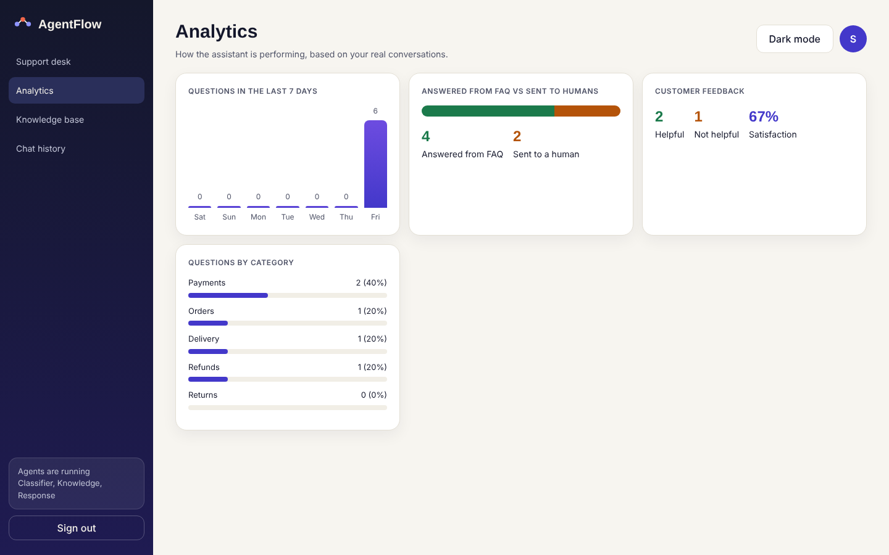
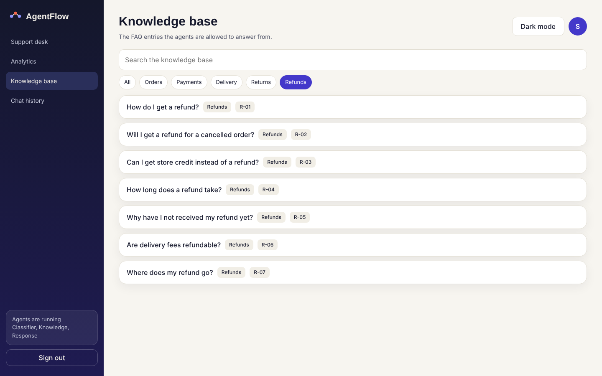
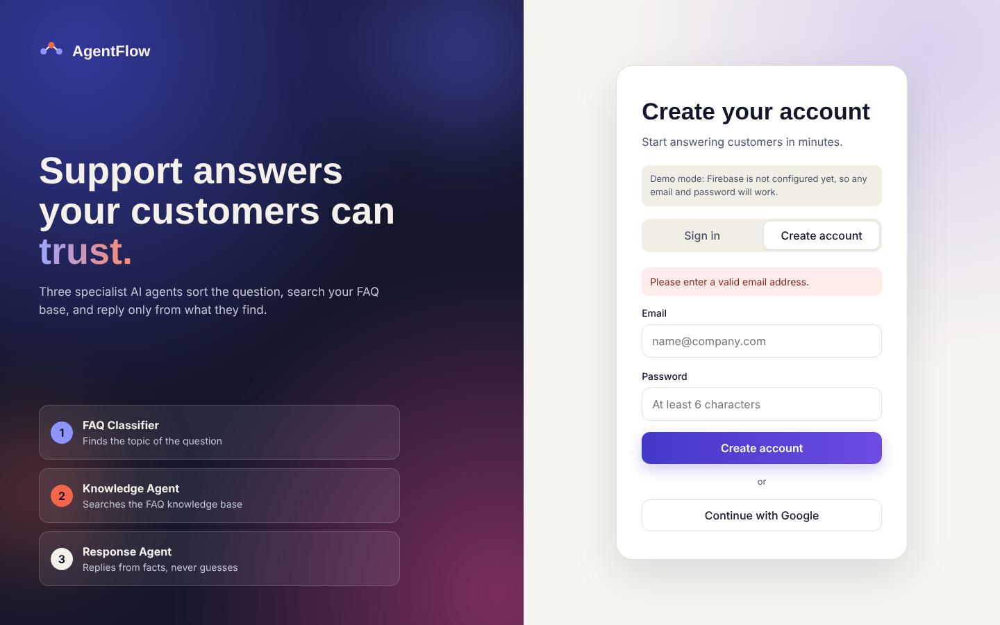
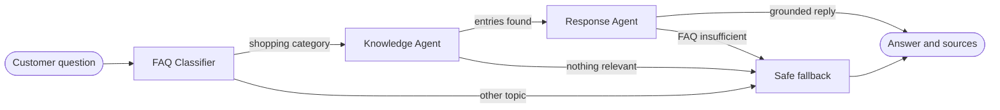
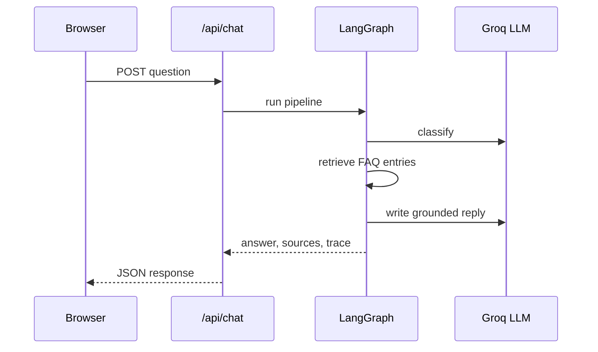

<div align="center">


# AgentFlow: AI-Powered FAQ Assistant

### Three AI agents. One honest answer. Never an invented policy.

A multi-agent customer support assistant for an online shopping company. It classifies each question, searches a predefined FAQ knowledge base, and replies **only from what it finds**. If the answer is not in the FAQ, it says so and offers human support.

<br>


<br>

[Features](#-features) · [Screenshots](#-screenshots) · [How it works](#-how-it-works) · [Quick start](#-quick-start) · [API](#-api-reference) · [Deployment](#-deployment) · [Docs](#-documentation)

<br>


</div>

---

## 📌 Overview

An online shopping company receives hundreds of customer questions about **orders, payments, deliveries, returns and refunds**. AgentFlow automates the first line of support with three specialised agents working as a pipeline. Every answer is grounded in the company's FAQ, shows its sources, and the system refuses to guess when information is unavailable.

> **Live demo:** _add your Vercel link here after deployment_

### The assistant must

| # | Requirement | How AgentFlow does it |
|---|---|---|
| 1 | Accept a customer question | Chat form (text or voice) and `POST /api/chat` |
| 2 | Identify the category | **FAQ Classifier** agent |
| 3 | Search a predefined FAQ knowledge base | **Knowledge Agent** (BM25 retrieval) |
| 4 | Generate a response from the available information | **Response Agent** (grounded reply) |
| 5 | Avoid inventing answers | Conditional fallback branch plus a `NOT_FOUND` rule |

### The agents

| Agent | Role | Responsibility |
|---|---|---|
| 🧭 **FAQ Classifier** | Question classification specialist | Understands the question and identifies its category |
| 📚 **Knowledge Agent** | FAQ knowledge specialist | Retrieves relevant entries from the knowledge base |
| 💬 **Response Agent** | Customer support specialist | Writes a clear reply grounded in the retrieved entries |

## ✨ Features

| | |
|---|---|
| 🤖 **Three-agent LangGraph pipeline** | Classifier, Knowledge and Response agents with conditional routing |
| 🛡️ **No-guessing guarantee** | Out-of-scope or unanswerable questions go to a fixed fallback that makes no LLM call |
| 👀 **Live agent pipeline** | Watch each agent finish in turn, with its result and the FAQ sources used |
| 🌍 **English and Roman Urdu** | Keywords, classification and replies work in both |
| 🔐 **Firebase Authentication** | Email and password plus Google sign-in on a custom login page |
| 🗂️ **Chat history** | Per-user history stored in Firestore |
| 📊 **Analytics dashboard** | Volume, answer rate, feedback, categories and unanswered questions from real conversations |
| 📖 **Knowledge base browser** | Search and filter all 31 FAQ entries |
| 👍 **Feedback** | Helpful and Not helpful on every answer |
| 🎙️ **Voice input** | Speak your question (in browsers that support speech recognition) |
| 🌗 **Dark and light mode** | Responsive layout for desktop and mobile |
| 🧪 **Demo mode** | Runs with no Firebase keys and no API key, ideal for quick testing |

## 🖼️ Screenshots

<table>
  <tr>
    <td align="center"><b>Login</b><br></td>
    <td align="center"><b>Live agent pipeline</b><br></td>
  </tr>
  <tr>
    <td align="center"><b>Support desk</b><br></td>
    <td align="center"><b>No-guessing fallback</b><br></td>
  </tr>
  <tr>
    <td align="center"><b>Analytics</b><br></td>
    <td align="center"><b>Knowledge base</b><br></td>
  </tr>
  <tr>
    <td align="center"><b>Chat history</b><br></td>
    <td align="center"><b>Dark mode</b><br></td>
  </tr>
  <tr>
    <td align="center"><b>Sign-up validation</b><br></td>
    <td align="center"><b>Mobile</b><br></td>
  </tr>
</table>

## 🧠 How it works



| Step | What happens |
|---|---|
| **1. Classify** | A fast Groq model returns `{category, confidence}` as JSON. If the LLM is unavailable, a keyword classifier (English and Roman Urdu) takes over. |
| **2. Retrieve** | BM25 ranks the FAQ entries. Entries in the predicted category get a boost, and a coverage threshold rejects weak matches. |
| **3. Respond** | The LLM may use only the retrieved entries and must reply `NOT_FOUND` if they do not answer the question. |
| **4. Fallback** | If anything fails the checks, a fixed message is returned. No model call, so nothing can be invented. |



## 🧰 Tech stack

| Layer | Technology |
|---|---|
| Agents | Python, LangGraph, LangChain-Groq |
| LLM | Groq (Llama models, configurable) |
| Retrieval | BM25 in pure Python (no extra service) |
| API | Vercel Python serverless functions |
| Frontend | HTML, CSS, JavaScript ES modules, no build step |
| Auth and data | Firebase Authentication and Firestore |
| Hosting | Vercel (site and API) and Firebase (auth and data) |

## 📁 Project structure

```
faq-assistant/
├── api/                      # Vercel serverless endpoints
│   ├── chat.py               # POST /api/chat
│   ├── faqs.py               # GET  /api/faqs
│   └── health.py             # GET  /api/health
├── backend/
│   ├── faq_assistant/
│   │   ├── agents/           # classifier.py, knowledge.py, responder.py
│   │   ├── knowledge_base/   # faqs.json (31 FAQ entries)
│   │   ├── graph.py          # LangGraph pipeline
│   │   └── config.py, llm.py, text.py, cli.py
│   └── tests/                # test_assistant.py, evaluate.py
├── frontend/
│   ├── index.html            # login and sign up
│   ├── app.html              # support desk, analytics, knowledge base, history
│   └── css/  js/  assets/
├── firebase/firestore.rules  # per-user Firestore security rules
├── docs/                     # screenshots, diagrams, report (.docx), presentation (.pptx)
├── dev_server.py             # run the whole app locally
├── vercel.json
├── requirements.txt
└── .env.example
```

## 🚀 Quick start

**Requirements:** Python 3.10 or newer and Git.

```bash
# 1. Clone
git clone https://github.com/scientistayat-engineer/agentflow-faq-assistant.git
cd agentflow-faq-assistant

# 2. Create and activate a virtual environment
python -m venv venv
venv\Scripts\activate          # Windows (PowerShell: .\venv\Scripts\Activate.ps1)
# source venv/bin/activate     # macOS / Linux

# 3. Install dependencies
pip install -r requirements.txt

# 4. Add your keys
copy .env.example .env         # macOS / Linux: cp .env.example .env
# then put your GROQ_API_KEY in .env

# 5. Run
python dev_server.py
```

Open **http://127.0.0.1:3000** and sign in.

> 💡 **No keys yet?** Skip step 4. Without `GROQ_API_KEY` the app runs in demo mode (keyword classifier and direct FAQ answers), and without Firebase keys, sign-in accepts any email and password with chats stored in the browser.

Try the agents from the terminal:

```bash
cd backend
python -m faq_assistant.cli "How long does a refund take?"
```

### Configuration

| Variable | Purpose | Default |
|---|---|---|
| `GROQ_API_KEY` | Groq API key | none (demo mode) |
| `CLASSIFIER_MODEL` | Model for the classifier | `llama-3.1-8b-instant` |
| `RESPONSE_MODEL` | Model for the response agent | `llama-3.1-8b-instant` |
| `SUPPORT_EMAIL` | Contact shown in the fallback message | `support@shopease.example` |

Firebase settings go in `frontend/js/config.js` (the web config values are not secrets).

## 💬 Example questions

| Question | Result |
|---|---|
| How long does a refund take? | ✅ Answered from FAQ R-04 |
| Mera refund kab tak aaye ga? | ✅ Answered from FAQ R-04 (Roman Urdu) |
| My payment failed but money was deducted | ✅ Answered from FAQ P-03 |
| Do you sell gift cards? | 🛡️ Fallback: not in the FAQ, nothing invented |
| What is the weather today? | 🛡️ Fallback: out of scope, retrieval skipped |

## 🔌 API reference

`POST /api/chat` with `{"question": "How long does a refund take?"}` returns:

```json
{
  "category": "refunds",
  "confidence": 0.75,
  "status": "answered",
  "answer": "Refunds usually reach your account within 5 to 7 working days ...",
  "sources": [{ "id": "R-04", "category": "refunds", "question": "How long does a refund take?", "score": 12.64 }],
  "trace": [
    { "agent": "FAQ Classifier", "status": "done", "summary": "Refunds (75% confidence)" },
    { "agent": "Knowledge Agent", "status": "done", "summary": "1 FAQ entry found" },
    { "agent": "Response Agent", "status": "done", "summary": "Grounded reply ready" }
  ]
}
```

| Endpoint | Method | Purpose |
|---|---|---|
| `/api/chat` | POST | Run the pipeline for a question (max 500 characters) |
| `/api/faqs` | GET | List the knowledge base |
| `/api/health` | GET | Report whether an LLM key is configured |

`status` is `answered` or `no_answer`.

## 🧪 Testing and evaluation

```bash
python -m unittest discover -s backend/tests   # 6 offline unit tests
python backend/tests/evaluate.py               # labelled evaluation
```

Demo-mode results (no LLM) on 28 in-scope and 6 not-in-FAQ questions:

| Metric | Result |
|---|---|
| Category accuracy | **28 / 28** |
| Correct FAQ ranked first | **27 / 28** |
| Questions not in the FAQ correctly refused | **6 / 6** |

> The question set was written by the author and the FAQ keywords were refined using it, so treat these numbers as a sanity check rather than an independent benchmark. Re-run the script with `GROQ_API_KEY` set to evaluate LLM mode.

## ☁️ Deployment

The app is designed for **Vercel** (site and API) and **Firebase** (Authentication and Firestore).

<details>
<summary><b>🔥 Firebase setup</b></summary>

1. Create a project in the [Firebase console](https://console.firebase.google.com).
2. Add a **Web app** and paste its config into `frontend/js/config.js`.
3. **Authentication** → Sign-in method → enable **Email/Password** and **Google**.
4. **Firestore Database** → Create database (production mode), then paste `firebase/firestore.rules` into the Rules tab and Publish.
5. After deploying to Vercel, add the Vercel domain under **Authentication → Settings → Authorized domains**.

</details>

<details>
<summary><b>▲ Vercel setup</b></summary>

1. Push this repository to GitHub and **Import** it in [Vercel](https://vercel.com).
2. Framework Preset: **Other**. Build Command: empty. Output Directory: `frontend` (already in `vercel.json`).
3. Add environment variable `GROQ_API_KEY` (and optionally `CLASSIFIER_MODEL`, `RESPONSE_MODEL`, `SUPPORT_EMAIL`).
4. **Deploy**, then open `/api/health` and check that `llm_configured` is `true`.

</details>

## 🛠️ Troubleshooting

| Problem | Fix |
|---|---|
| PowerShell will not activate the venv | Run `Set-ExecutionPolicy -Scope CurrentUser RemoteSigned`, then activate again |
| Page loads slowly on `localhost` | Open `http://127.0.0.1:3000` instead |
| Google sign-in says unauthorized domain | Add the domain (including `127.0.0.1` for local tests) under Firebase Authorized domains |
| Chats are not saved after login | Check `frontend/js/config.js` values and that the Firestore rules are published |
| Answers look plain and unformatted | No `GROQ_API_KEY` is set, so demo mode is active. Check `/api/health` |
| `venv/` got committed to Git | `git rm -r --cached venv` then commit again; `venv/` must be in `.gitignore` |

## 🗺️ Roadmap

- [x] Three-agent LangGraph pipeline with fallback branch
- [x] Login, support desk, analytics, knowledge base and history
- [x] English and Roman Urdu support
- [x] Offline tests and labelled evaluation
- [ ] Verify Firebase ID tokens in the API and add rate limiting
- [ ] Embedding-based semantic search
- [ ] Admin screen to edit FAQs and promote unanswered questions
- [ ] Live order data and multi-turn memory

## 📚 Documentation

| Document | Location |
|---|---|
| Project report (Word) | [`docs/AgentFlow-Project-Report.docx`](docs/AgentFlow-Project-Report.docx) |
| Presentation (PowerPoint) | [`docs/AgentFlow-FAQ-Assistant.pptx`](docs/AgentFlow-FAQ-Assistant.pptx) |
| Screenshots and diagrams | [`docs/`](docs) |

## 👩‍💻 Author

**Anushay Ayat**, Roll No. 773317
AI and Data Science, Saylani IT Training
Instructor: Mehwish Alam

[](https://github.com/scientistayat-engineer)

## 🙏 Acknowledgements

[LangGraph](https://langchain-ai.github.io/langgraph/), [Groq](https://groq.com), [Firebase](https://firebase.google.com) and [Vercel](https://vercel.com). BM25 follows Robertson and Zaragoza (2009).

## 📄 License

Released under the MIT License. See [LICENSE](LICENSE).

<div align="center">

⭐ If you found this project useful, please give it a star.

</div>